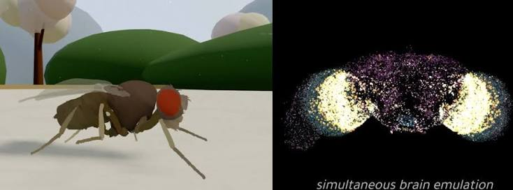
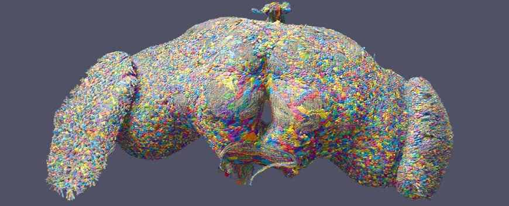

# Desktop Fly Connectome Simulation on Your Desktop

Desktop Fly presents a procedural insect alongside a live neural visualization.
Desktop Fly Simulator connects extracted fruit fly circuits with modeled movement and desktop stimuli.

The upstream application is named DesktopFly and is maintained by DenisSergeevitch.
This repository documents that project and includes separately identified research reference files.

[](https://desktop-fly.github.io/Desktop-Fly-Simulator/)

## What's real

Desktop Fly connectome simulation combines anatomical connection data with chosen neuron dynamics.
Desktop Fly FlyWire simulation uses an extracted brain circuit rather than every cell in the source dataset.
Desktop Fly fruit fly simulator also connects a MaleCNS locomotor extract to modeled articulated legs.

The following distinctions help interpret what appears on screen:

| Element | Data or implementation basis | Interpretation |
| --- | --- | --- |
| Brain point cloud | FlyWire neuron positions | Spatial context for displayed activity |
| Extracted connections | Published connectivity and contact counts | Anatomical constraints on the network |
| Neural spikes | Leaky integrate-and-fire dynamics | Outputs of a configured computational model |
| Walking body | Procedural geometry and articulated mechanics | A modeled response to motor signals |
| Sensory feedback | Joint state and contact estimates | Inputs computed from the simulated body |
| Alternate beetle | Replacement body geometry | A visual form using the same behavior contract |

The brain visualization and the active neural circuit represent different selections of cells.
A visible neuron location does not by itself imply a simulated cell with calibrated physiology.

The inspected [BrainView.swift](BrainView.swift) builds a SceneKit point cloud with per-point colors.
The inspected [FlyModel.swift](FlyModel.swift) defines body geometry and movement-related parameters.



## Controls (menu bar)

The macOS application exposes controls through its menu-bar item.
Upstream controls include pausing, showing the brain, injecting a looming stimulus, and managing flies.

Use the brain view to compare a stimulus with the resulting activity.
Use pause and resume when examining a particular body pose or transition.

For a short observation session:

1. Show the brain view and observe the resting display.
2. Trigger the menu's looming-stimulus test.
3. Compare the highlighted activity with the visible escape response.
4. Repeat under the same conditions before interpreting a difference.

The entry point is [main.swift](main.swift), which also dispatches diagnostic command-line modes.
An alternate stag-beetle geometry is defined in [BeetleModel.swift](BeetleModel.swift).

Changing body geometry is not evidence that a different species' neural circuit is simulated.
Describe the selected appearance separately from the circuit that drives it.

## How real neurons drive the body

DesktopFly routes signals through identified pathways and a modeled interface to the body.
The brain and locomotor extracts originate from different specimens.

[Locomotor.swift](Locomotor.swift) defines the locomotor graph representation and validates its structure.
Its checks include unique neuron IDs, finite edge values, valid indices, and motor-channel coverage.

[LegDynamics.swift](LegDynamics.swift) defines motor commands, articulated-leg feedback, and body motion.
The inspected comments identify inertia, damping, joint limits, and ground-contact approximations as model choices.

This Swift example constructs a motor-command value using fields present in the source:

```swift
var command = LegMotorCommand()
command.protract = 0.15
command.lift = 0.10
command.extend = 0.05
```

The numbers above are illustrative inputs to a source-level type.
They are not measured muscle activations or a supported application settings file.

The feedback structures include joint angles, velocities, foot position, and contact state.
Such values describe the modeled body at a particular step.

## Desktop ecology (all permission-free macOS senses)

The macOS environment layer provides signals derived from the desktop.
These are abstractions of sensory input for the simulated insect.

[Environment.swift](Environment.swift) inspects on-screen window information and tracks window identities.
Its source also describes clock, idle-state, and thermal-state inputs.

Window edges supply desktop terrain, while changing windows can provide a looming cue.
Desktop time and activity supply environmental context rather than biological recordings.

For an interpretable demonstration:

- Keep the same screen arrangement between observations.
- Note whether windows moved or appeared near the fly.
- Record the stimulus used instead of describing every reaction as spontaneous.
- State which platform and source revision produced the observation.



The native Swift source imports Cocoa and SceneKit.
Upstream also documents a separate Windows port; that port is absent from this file selection.

## Regenerating the data

The project uses extraction scripts to produce compact inputs from published datasets.
Extraction and simulation are different stages with different dependencies.

[etl.py](etl.py) reads FlyWire Codex tables and prepares visualization and circuit outputs.
Its inspected input description names classification, coordinates, connectivity, and cell-type tables.

[etl_malecns.py](etl_malecns.py) extracts an anatomically identified leg circuit from MaleCNS tables.
Its imports include NumPy, pandas, and PyArrow, and its parser supports separate input and output locations.

The following Bash example uses that parser with explicit working directories:

```bash
raw_dir="/tmp/desktop-fly-malecns"
output_dir="/tmp/desktop-fly-derived"
python3 etl_malecns.py "$raw_dir" --out "$output_dir" --download
```

This optional command downloads source tables and writes derived output.
It requires the extractor's dependencies and sufficient storage; it was not executed for this review.

The current selection does not include the upstream data directory or every Swift compilation input.
The inspected [build.sh](build.sh) references an additional simulation source absent from this collection.

Use a complete upstream checkout and its matching data when preparing an executable.
The files here should not be presented as a verified standalone build.

## Diagnostics

The application includes headless checks and offscreen rendering modes.
These examples assume an already compiled macOS executable with the required data available.

```bash
./DesktopFly --simtest
./DesktopFly --brainshot desktop-fly-neurons.png
./DesktopFly --snapshot desktop-fly-overhead.png --top --beetle
```

The first command requests circuit checks; the other commands request image output.
No diagnostic commands were run while preparing this document.

[LocomotorTests.swift](LocomotorTests.swift) evaluates the graph and articulated-body model.
Its opening comments explicitly distinguish software checks from validation against recorded living flies.

The collection also includes two flybody test references from a separate MuJoCo project:

- [common.py](tests/common.py) contains actuator-related test helpers.
- [test_core.py](tests/test_core.py) creates and steps a flybody environment.

Those Python tests do not exercise DesktopFly.
Their presence does not add MuJoCo or reinforcement-learning functionality to the desktop application.

## Documentation

For the complete project, consult the [upstream DesktopFly documentation](https://github.com/DenisSergeevitch/desktop-fly).
Its explanations cover platform requirements, controls, diagnostic modes, and data provenance.

The bundled flyvis references belong to a separate visual-system modeling framework:

- [flyvis_cli.py](flyvis_cli/flyvis_cli.py) dispatches pipeline operations.
- [init_config.py](flyvis_cli/init_config.py) copies package configuration templates into a local directory.
- [record.py](flyvis_cli/analysis/record.py) launches synthetic recording jobs across ensemble models.

These files provide research context rather than a DesktopFly command interface.
Their required flyvis package and configuration resources are not included in this selection.

## What's modeled vs. measured

Measured wiring constrains a model without supplying every physiological parameter.
Neuron dynamics, sensory tuning, cross-specimen signal transfer, and muscle mechanics require assumptions.

A successful software check establishes only the properties that the check measures.
Biological agreement requires a separate comparison with experimental observations.

DesktopFly's procedural body is distinct from the MuJoCo models used by flybody and NeuroMechFly.
The reference projects should retain their own names, assumptions, and attribution.

## License & citation

The upstream documentation identifies DesktopFly code as MIT-licensed.
It assigns CC BY-NC 4.0 to the original FlyWire-derived data and CC BY 4.0 to the MaleCNS-derived data.

Preserve the relevant notices and dataset attribution when redistributing material.
The separate flybody and flyvis files retain their own upstream terms.

## Related Search Terms

Desktop Fly, Desktop Fly Simulator, Desktop Fly connectome simulation, Desktop Fly FlyWire simulation, Desktop Fly fruit fly simulator, drosophila, biomechanics, physics-simulation, neuroai, mujoco, deep-learning, reinforcement-learning, simulation
